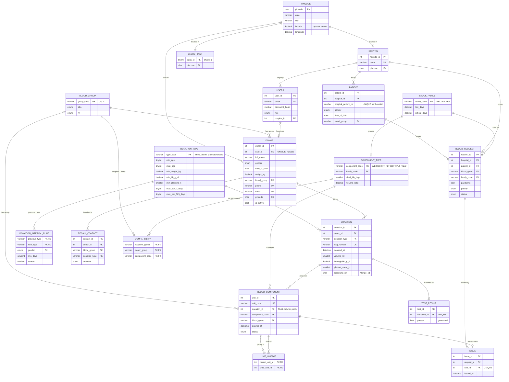

# ER diagram and relational schema

Blood Component Inventory & Emergency Matching System. MySQL holds the relational core;
MongoDB holds the screening questionnaires and the unit audit log (see the end of this file).

## Ownership

| Table / object | Owner | File |
|---|---|---|
| blood_group, stock_family, component_type, pincode, blood_bank | shared | `db/01_shared_reference.sql` |
| donation_type, donation_interval_rule, donor, donation, blood_component, unit_lineage, recall_contact; split / pool procedures; `v_unit_status` | Member A | `db/10_a_donor_donation.sql` |
| hospital, patient, users, compatibility, test_result, blood_request, issue | Member B | `db/20_b_core_tables.sql` |
| forecast views, recall procedure | Member A | `db/30_a_forecast_recall.sql` |
| roles, grants, restricted views | Member A | `db/40_a_access_control.sql` |

## Relationships and cardinality

| Relationship | Cardinality | Enforced by |
|---|---|---|
| donor – donation | 1 : N | `fk_donation_donor` |
| donation – blood_component | 1 : N (WB + RBC/FFP/PLT, or 1 SDP; aliquots too) | `fk_unit_donation`, `sp_record_donation` |
| blood_component – blood_component | **M : N** through `unit_lineage` (a pool has 4-6 parents) | `fk_lineage_parent`, `fk_lineage_child` |
| donor – users | 0..1 : 0..1 | `donor.user_id` UNIQUE + `fk_donor_user` |
| donation – test_result | 1 : 0..1 | `test_result.donation_id` UNIQUE |
| patient – blood_request | 1 : N | `fk_request_patient` |
| blood_request – issue | 1 : N | `fk_issue_request` |
| blood_component – issue | 1 : 0..1 | `issue.unit_id` UNIQUE |
| donor / hospital / bank – pincode | N : 1 | `fk_donor_pincode`, `fk_hospital_pincode`, `fk_bank_pincode` |

## Design decisions (and how to defend them in the viva)

**Why does safety recall need recursion?** Units form a graph, not a fixed two-level tree:
whole blood → red cells → paediatric aliquots (three levels), and a platelet *pool* is made from 4-6
units from *different donors*, so it has several parents and no single `donation_id`. Filtering by
`donation_id` misses every pool; a fixed number of self-joins breaks as soon as processing gains a level.
A recursive CTE over `unit_lineage` follows the graph to any depth. (Tested in
`db/tests/a_donor_donation_tests.sql`: "Recursive trace from one donor reaches the pooled unit".)

**Where are the patients?** `patient` stores the hospital's own patient number (MRN), sex, date of birth
and group — no names, because the blood bank does not need them: a safety recall tells the hospital which of
*its* patients received an affected unit. Path: `issue → blood_request → patient`. The patient sits on the
request (not duplicated on each issue row) because every unit issued against a request goes to that patient.

**How is distance computed?** Donors give a PIN code, which is easy to know and to verify; the `pincode` table
holds an approximate centre point for each code. Distance = great-circle distance between the donor's and the
blood bank's PIN-code centres (`ST_Distance_Sphere`). Inside a city this is accurate to about 1-3 km, which is
enough to rank "nearby" donors, and it is never a made-up number. Unknown PIN codes are rejected (FK).

**Why a rule table for eligibility?** Gaps depend on sex *and* on the pair of donation types (whole blood →
whole blood 90/120 days, apheresis → apheresis 48 h, apheresis ↔ whole blood 28 days), plus apheresis caps
(2 a week, 24 a year), a platelet count ≥ 150, different age / weight limits, and first-time whole-blood
donors must be 60 or younger. Hard-coding one number would be wrong; the trigger reads `donation_type` and
`donation_interval_rule`, and each rule row carries its source. If the guideline changes, one row changes.
Source: NBTC/NACO *Guidelines for Blood Donor Selection & Blood Donor Referral* (2017), as summarised by
blood centres; the platelet-count threshold is standard apheresis practice rather than part of that summary.

**What if the MySQL Event Scheduler is disabled?** The nightly expiry job (Member B) is an optimisation for
the stored `status` column, not a correctness dependency. Every stock query reads `v_unit_status`, which reports
any unit past `expires_at` as `expired` when read. `db/setup-mysql.sh` turns the scheduler on and
`npm run db:test` reports whether it is running.

**`blood_component.blood_group` is copied from the donor** at collection time. It is technically derivable
through `donation → donor` (and impossible to derive for pools, which have no donation), and allocation and
stock queries filter on it constantly. All other tables are in 3NF.

## MongoDB collections

| Collection | Owner | Why not a table |
|---|---|---|
| `questionnaire_templates` | Member A | Questions change over time (new versions) and have nested rules (`showIf`, `defer`). |
| `screening_responses` | Member A | One document per visit with a variable list of answers; links to MySQL by `donorId`, and `donation.screening_ref` stores the document `_id`. |
| `audit_log` | Member B | Append-only stream of unit status events. |

Validators (`$jsonSchema`) and indexes are created by `scripts/mongo-init.mjs`.
